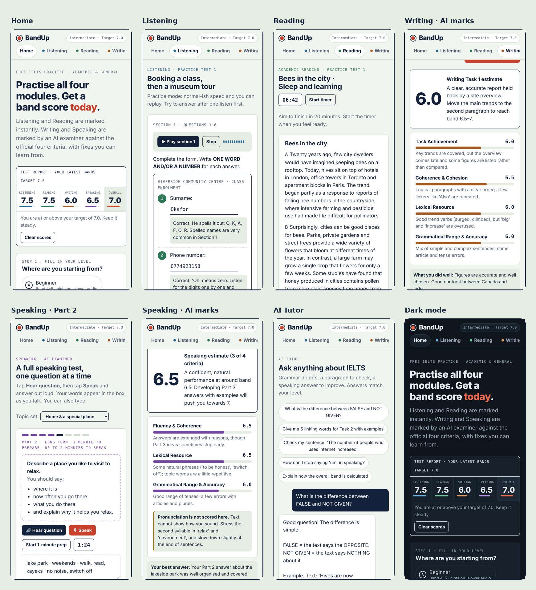

# BandUp IELTS

Free IELTS practice website: Listening and Reading marked instantly, Writing and Speaking marked by an AI examiner, level-based tips, an AI study plan and an AI tutor.



## What makes it work

- **LLM as examiner, not a chatbot.** Writing and Speaking are marked against the four public IELTS criteria. The model returns typed JSON (band + reason per criterion, corrections, next step), and the page rebuilds the overall band with the official rounding rules in code.
- **Prompts stay on the server.** The browser sends only the task id and the answer; `api/ai.js` builds the examiner prompt. Visitors cannot turn the site into a free general-purpose AI proxy.
- **Honest limits in the product.** Pronunciation is not scored, because only text reaches the examiner; the result says so.
- **Cost control.** Per-visitor daily limit (Upstash Redis, with an in-memory fallback), cheap model for tutor and plans, stronger model for marking.
- **Levels change behaviour,** not just labels: audio speed, one-play exam mode, timers, hints and feedback tone.

## How it is built

```
public/index.html   the whole website (HTML, CSS, JS — no build step)
api/ai.js           serverless route that calls Claude for marking, plan and tutor
api/_content.js     the Writing/Speaking prompts the examiner marks against
vercel.json         Vercel settings
```

The AI prompts live on the server, so visitors can only ask for IELTS marking and tutoring, not use your key for anything else. Each visitor gets `DAILY_LIMIT` AI checks a day.

## Deploy to Vercel (about 10 minutes)

1. **Get an API key** at https://console.anthropic.com → API Keys. Add a little credit and set a monthly spend limit (Settings → Limits) so costs can never surprise you.
2. **Put the code on GitHub**: create a new repository, then drag all the files from this folder into it (Add file → Upload files) and commit.
3. **Import into Vercel**: https://vercel.com/new → pick the repository → Framework preset **Other** → leave build settings empty.
4. **Add the key**: before clicking Deploy, open *Environment Variables* and add `ANTHROPIC_API_KEY`. Then Deploy.
5. **Make the limit reliable** (recommended): in the Vercel project, Storage → Create → Upstash Redis (free tier) → connect it. Vercel adds `UPSTASH_REDIS_REST_URL` and `UPSTASH_REDIS_REST_TOKEN` for you (if it names them `KV_REST_API_URL` / `KV_REST_API_TOKEN`, add two more variables with the names above and the same values). Redeploy.

Alternative to steps 2–4: install Node, then in this folder run `npx vercel`, log in, and `npx vercel env add ANTHROPIC_API_KEY` followed by `npx vercel --prod`.

## Run it locally

```
npx vercel dev
```

## Cost guide

Every Writing or Speaking mark is one Sonnet call; tutor messages and study plans use Haiku. Check current prices at https://www.anthropic.com/pricing and watch usage in the Anthropic console. Lower `DAILY_LIMIT` or switch `MODEL_MARK` to Haiku if costs grow.

## Notes

- Speaking uses the browser's speech recognition (Chrome, Edge, Safari, Android). Other browsers fall back to typing or keyboard dictation. Pronunciation is not scored, because only text reaches the examiner.
- Practice content is original and written in the IELTS format. Official free material is linked on the Learn page.
- IELTS is a registered trademark of the British Council, IDP and Cambridge University Press & Assessment. BandUp is not affiliated with them.
